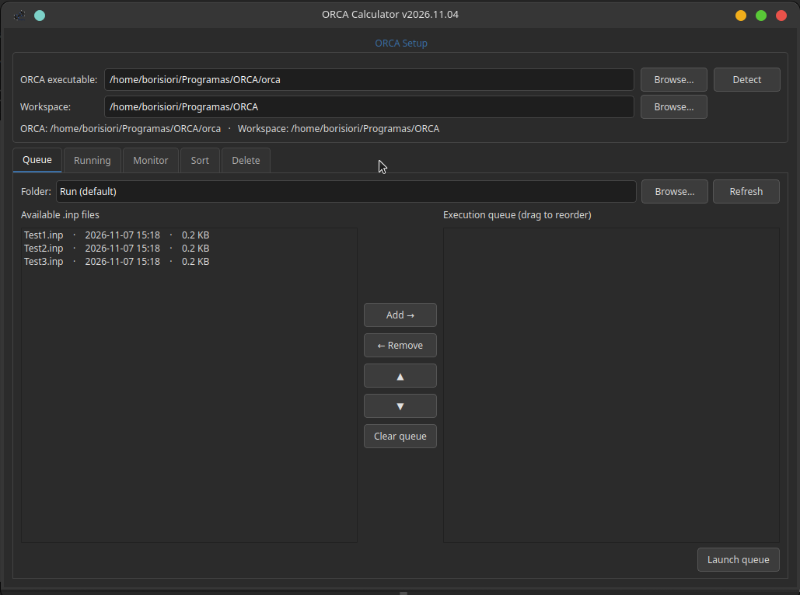
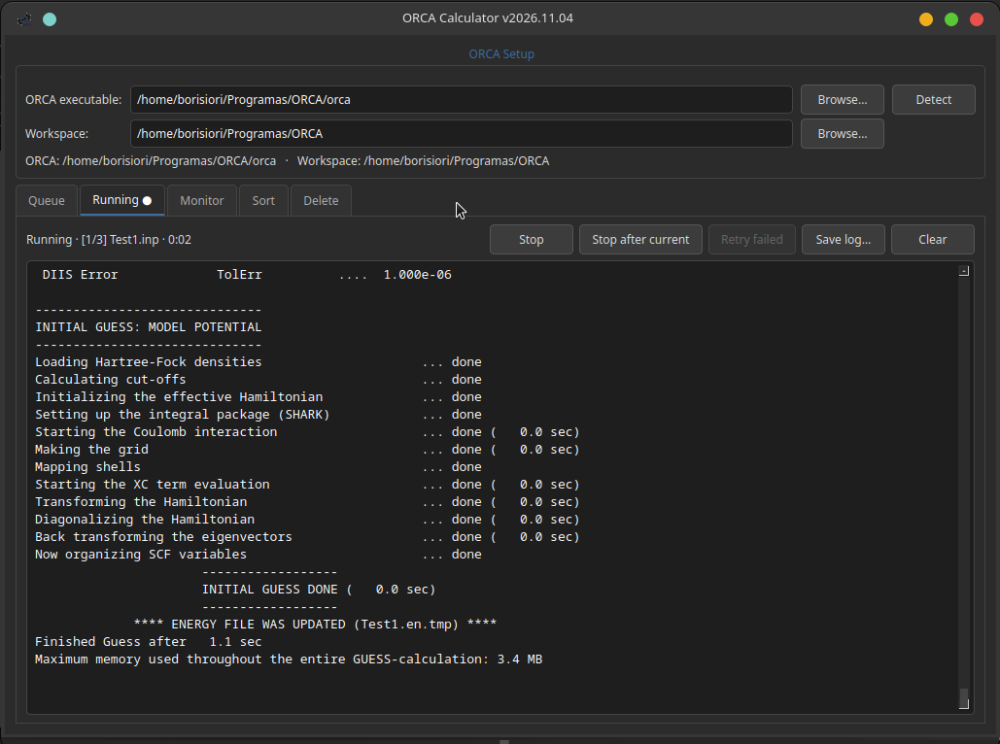
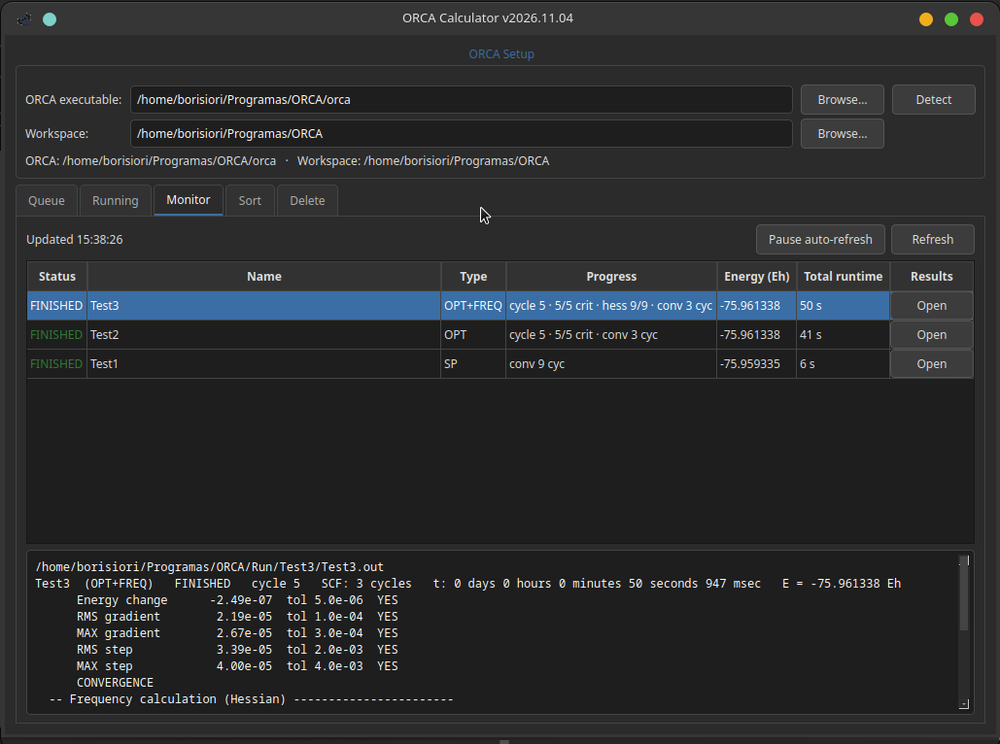
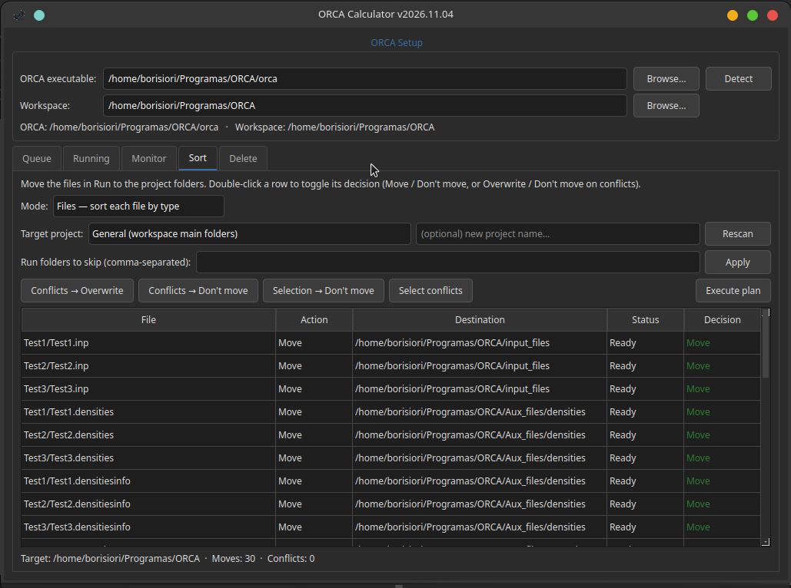
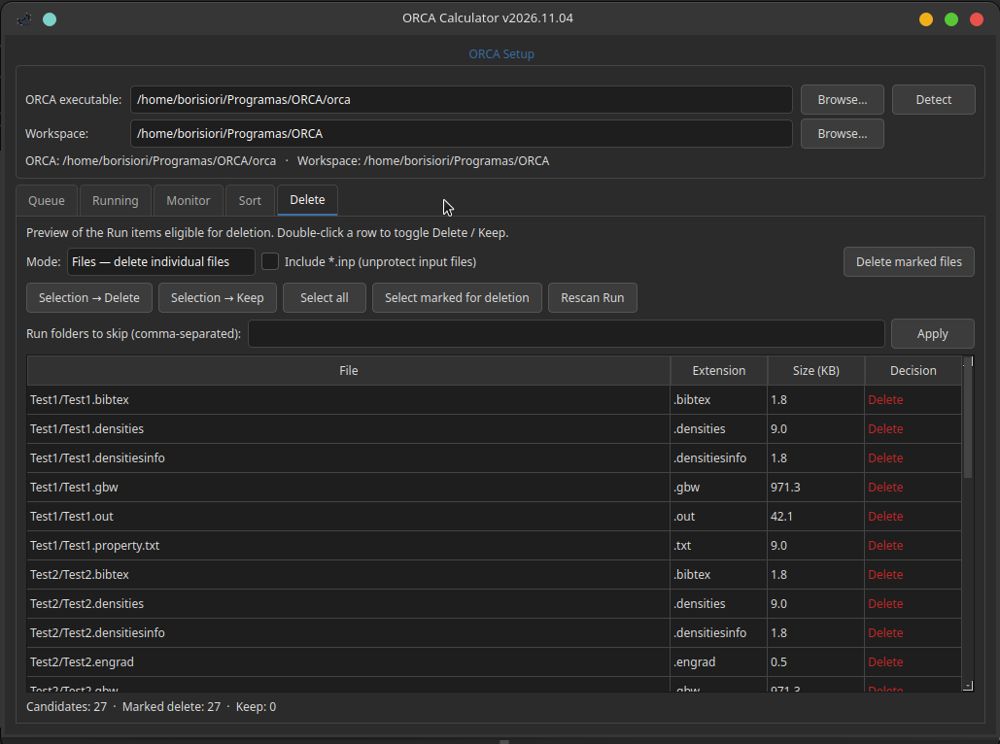

# MoleditPy ORCA Calculator Plugin

### 🎬 Demo video

https://github.com/user-attachments/assets/28b253a4-fdec-438c-b9c7-a5a4cdc35580

*(A 4½-minute walkthrough of all five tabs, with narration.)*

A job queue manager for the [ORCA](https://www.faccts.de/orca/) quantum
chemistry package, running inside
[MoleditPy](https://github.com/HiroYokoyama/python_molecular_editor).
Load existing `.inp` files (create them with the *ORCA Input Generator Pro*
plugin), run them as a sequential queue with live output, watch their
progress, and keep the results workspace organized.

The dialog has a setup bar plus five tabs: **Queue → Running → Monitor →
Sort → Delete**, following the life cycle of a calculation batch.

---

## ORCA Setup (top bar)

Before anything runs, the plugin needs to know where ORCA lives. Both fields
are auto-detected on first open and remembered across sessions (stored in
MoleditPy's application settings, not in the project file):

- **ORCA executable** — the full path to the `orca` launcher. Detection order:
  the `ORCA_BIN` environment variable, `ORCA_HOME`, the `PATH`, then common
  install folders (`/opt`, `/usr/local`, the home folder…). **Browse…** picks
  it manually; **Detect** re-runs the automatic search.
- **Workspace** — the root folder that holds `Run/` (default input folder),
  `temp/` (scratch) and the project structure
  (`input_files/`, `output_files/`, `output_analysis/`, `Aux_files/`). It
  defaults to the ORCA installation folder and both missing subfolders are
  created automatically when needed.

The status line under the fields reports whether the executable is usable;
launching is blocked until it is.

## Queue tab



Builds the ordered list of calculations to run:

- **Folder selector** — a drop-down with every input folder of the workspace:
  `Run/` (default), the workspace root, the general work subfolders and every
  detected project folder (with their own `Run/` and work subfolders). Folders
  added through **Browse…** are remembered as "(extra)". **Refresh** re-reads
  the current folder.
- **Available .inp files** — every input in the selected folder with its
  modification date and size. Double-click (or select several and press
  **Add →**) to append them to the queue.
- **Execution queue** — the ordered list, numbered `[1] [2] …`. Reorder by
  dragging rows or with **▲ ▼**; **← Remove** and **Clear queue** trim it.
- **Launch queue** — runs the list in order and switches to the Running tab.
  While a queue is active the tab locks (the launcher writes into `Run/`).
- The last used folder is saved with the project file and restored on open.

## Running tab



The live console of the queue, job by job:

- Raw ORCA output streams here as it is produced; the header line shows
  `[i/n] file.inp — RUNNING` and the elapsed time ticks every second.
- **Stop** — kills the whole process tree immediately (ORCA and its helper
  processes), after a confirmation. The current `.out` stays half-written.
- **Stop after current** — graceful stop: the file running now finishes
  normally (results collected, input moved into its results folder) and the
  remaining files are not started.
- **Retry failed** — re-queues only the files that ended with errors; the
  button tooltip lists them.
- **Save log…** writes the console to a `.log` file; **Clear** wipes it.
- When the queue ends, a large launcher-style banner summarizes the outcome:
  `ALL FILES IN QUEUE FINISHED SUCCESSFULLY`, the failure list, or
  `QUEUE STOPPED`.

On success, everything a job produced is collected into `Run/<name>/` — and
the input file itself is **moved inside** that folder, so each run lives
together with no loose duplicates. On error the input stays loose (so *Retry*
works) and the raw scratch folder is kept under `temp/` for inspection.

## Monitor tab



A read-only status table of every `.out` in `Run/` and `temp/`, refreshed
every 10 seconds in a background thread (the interface never freezes), with
**Pause auto-refresh** and **Refresh** controls:

- **Status** — Running (amber), Finished (green), FAIL (red) or STALE (a
  half-written `.out` nobody is writing anymore). Running jobs sort first,
  newest first.
- **Progress** — one compact line per job type, never empty: SP → `SCF 37/100`
  or `conv 12 cyc`; OPT → `cycle 12 · 4/5 crit` (converged criteria) plus its
  SCF; FREQ/OPT+FREQ → analytic Hessian `hess 84/90` (or the integrals
  `batch 3/~5` before it); relaxed scan → `step 7/21`; OptTS → cycle,
  criteria and Hessian count; finished frequency jobs → `42 freqs · 1 imag`.
- **Energy (Eh)** — final single point energy at six decimals.
- **Total runtime** — ORCA's own timing, compacted (`1 h 43 m`, `2 m 09 s`).
- **Detail panel** — clicking (or hovering) a row shows the full block below
  the table: summary line, convergence criteria table with YES/NO against
  each tolerance, SCF convergence lines, and — for frequency jobs — the
  stage checklist `Integrals → CP-SCF equations (with ETA) →
  Diagonalization → Thermochemistry`, plus imaginary frequencies, ZPE and
  Gibbs. For OptTS runs it ends with `TS CONFIRMED` when exactly one
  imaginary mode is present.
- **Results → Open** — appears only on jobs that finished correctly: launches
  `moleditpy <file.out>` as a separate session, which routes through the
  plugin file openers (the *ORCA Result Analyzer* picks up `.out` files when
  installed). Your current session is never disturbed.

Selection and scroll survive every refresh, so reading is never interrupted.

## Sort tab



Moves finished work out of `Run/` into the project structure — with a full
preview before anything happens:

- **Mode: Files** — each file goes to its type subfolder using the standard
  mapping (`.inp` → `input_files/`, `.out` → `output_files/`, `.gbw`/`.hess`/
  `.opt`… → `Aux_files/<kind>/`). `.bibtex` files are **moved to
  `Aux_files/bibtex/`, never deleted** (scientific transparency).
- **Mode: Folders** — each per-run folder moves **intact** to
  `output_files/<name>/`, taking its companion `.inp` inside: the run keeps
  its identity in the target project.
- **Target project** — pick from the list (detected projects + the general
  workspace folders) or type a **new project name**: every folder is created
  on demand at execution time.
- **Exclusions** — top-level `Run/` folders to skip, comma-separated,
  persisted in the workspace.
- **Decisions** — double-click a row to toggle Move/Don't move (or
  Overwrite/Don't move on conflicts); bulk buttons decide selected conflicts
  or mark the selection as Don't move; **Select conflicts** highlights them.
  Conflicts (target already exists) are amber and default to not moving.
- **Execute plan** — asks for confirmation with a summary, then moves; the
  status line reports moved/overwritten/skipped/errors, and emptied run
  folders are removed from `Run/`.

Locked while a queue is running.

## Delete tab



Selective cleanup of `Run/`, with the same two modes:

- **Mode: Files** — every file individually (size and extension listed).
- **Mode: Folders** — each per-run folder as one unit, with the total folder
  size.
- **Include `*.inp`** — inputs are **protected by default**; opt in to also
  delete loose inputs (Files mode) or each run's companion `.inp` together
  with its folder (Folders mode, shown as `name/ (+ .inp)`).
- Double-click toggles Delete/Keep; bulk buttons decide the selection; the
  counter tracks marked vs kept. **Delete marked files** asks for
  confirmation with a preview and removes emptied folders afterwards.
- The same exclusion list as Sort (stored separately).

---

## Tested calculation types (monitor parser)

The monitor's `.out` parser has been verified against real ORCA 6.x outputs
for the following job types; other kinds of calculation are not specially
parsed (they still appear in the table with their status, energy and SCF,
but the Progress column stays generic):

| Job type | Status & progress | Extra detail verified |
|---|---|---|
| **SP** (single point) | SCF iteration `n/max` or `conv N cyc` | SCF convergence criteria, non-convergence warnings |
| **OPT** | cycle + converged criteria (`4/5 crit`) | convergence table with YES/NO per criterion |
| **FREQ / OPT+FREQ** | analytic Hessian (`hess 84/90`, integrals `batch n/~m`) with ETA | stage checklist (integrals → CP-SCF → frequencies → thermochemistry), imaginary frequencies, ZPE, Gibbs |
| **Relaxed SCAN** | `step n/total`, step-aware convergence | per-step criteria without leakage between steps |
| **OptTS / OptTS+FREQ** (incl. `Calc_Hess`) | cycle + criteria, initial/recalc Hessian count | TS confirmation (exactly one imaginary mode) |
| **GOAT** | global iteration + conformers | parsing inherited from the original monitor; exercised through unit tests only |

Not yet parsed: excited-state results (TDDFT), NEB, IRC and other rarer job
types. If your favorite is missing, open an issue with a (truncated) `.out`
sample.

## Requirements

- **Linux only, and only Linux is supported or tested.** Windows and macOS
  are not supported: process-tree control reads `/proc` and the monitor uses
  `fuser`, both Linux tools. (`PLUGIN_SUPPORTED_OS` declares this; MoleditPy
  shows it in the plugin explorer.) For anyone willing to pick up the port
  someday, `proc.py` and `monitor_core.py` already carry clearly-marked
  best-effort branches for the other platforms — pull requests welcome.
- ORCA installed locally (any recent version). The plugin must call the ORCA
  launcher through its full path.
- No extra Python packages: PySide6 ships with MoleditPy.

## Compatibility

- MoleditPy `>=5.0.0, <6.0.0`
- Python `>=3.10, <3.15`
- ORCA 6.x (developed and tested against 6.1.1; any version printing the
  standard banners is expected to work)

## Setup

1. Put the `orca_calculator` folder into your MoleditPy `plugins` directory
   (`~/.moleditpy/plugins/`).
2. Start MoleditPy and open **Extensions → ORCA Calculator…**.
3. First run only: check the ORCA Setup bar (auto-detected on open; use
   **Browse…** if detection fails). The binary path and the workspace folder
   are remembered.

## Testing

Two levels, both from the repository root:

```bash
# fast suite with a fake ORCA executable (no ORCA needed)
QT_QPA_PLATFORM=offscreen python -m pytest tests/

# full pipeline against a real ORCA binary (H2/HF/STO-3G, ~30 s)
QT_QPA_PLATFORM=offscreen python tests/e2e_real_orca.py
```

## Version

- 2026.11.04 — Initial release.

## Author

- **borisiori** — [github.com/borisiori](https://github.com/borisiori)

## License

Licensed under the **GNU Lesser General Public License v3.0 or later**
(LGPL-3.0-or-later) — the same license as MoleditPy. See [LICENSE](LICENSE)
for the LGPL text and [COPYING](COPYING) for its companion GPLv3 text.
The plugin links to PySide6/Qt (LGPLv3), which is bundled with MoleditPy and
is not redistributed here. ORCA itself is proprietary software of FACCTS;
this plugin only launches a local installation and ships none of its code.

The software is provided 'as is' without warranty of any kind. Users are
responsible for validating their computational results.

## Acknowledgments

- [MoleditPy](https://github.com/HiroYokoyama/python_molecular_editor) by
  HiroYokoyama, for the molecular editor and its clean plugin API.
- The *PySCF Calculator* plugin, used as the architectural reference for
  this plugin.
